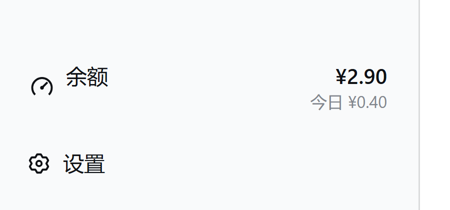
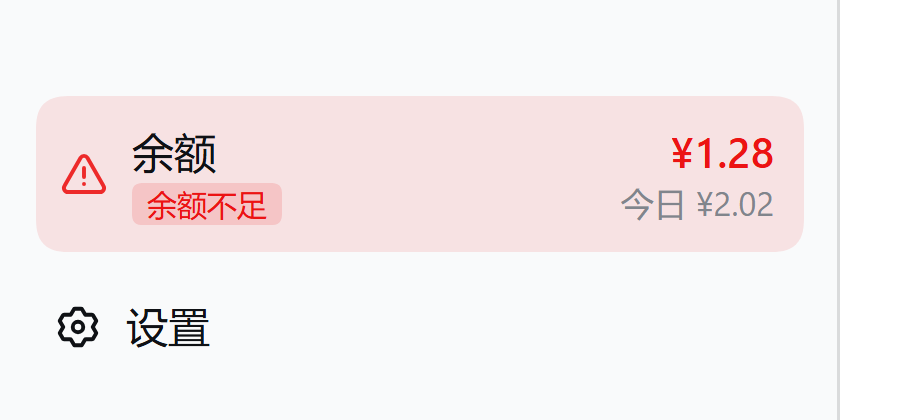
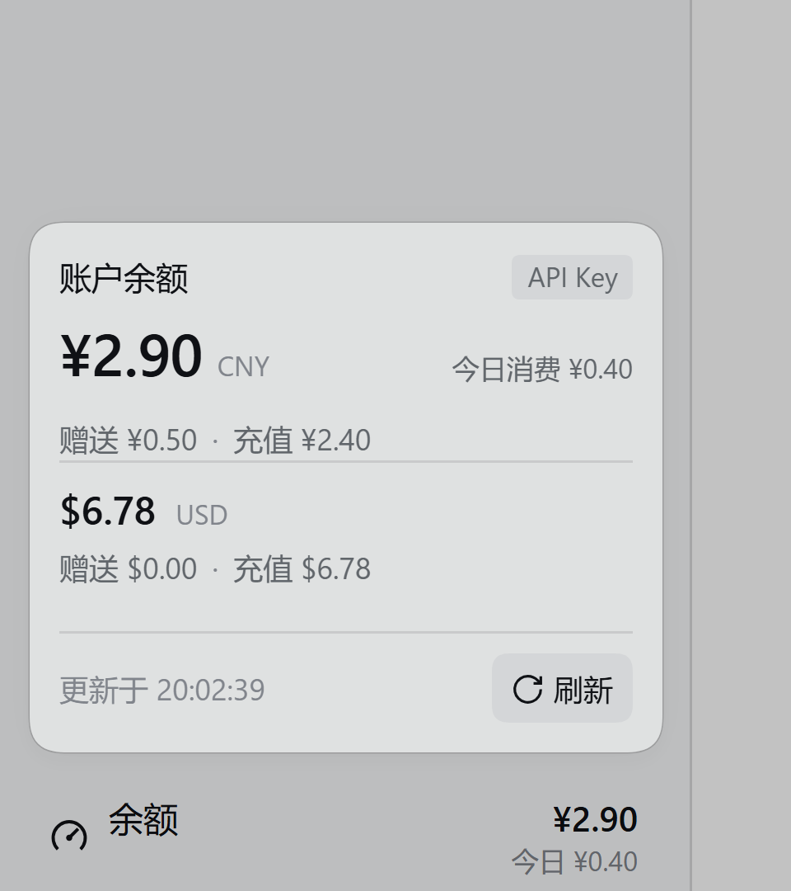
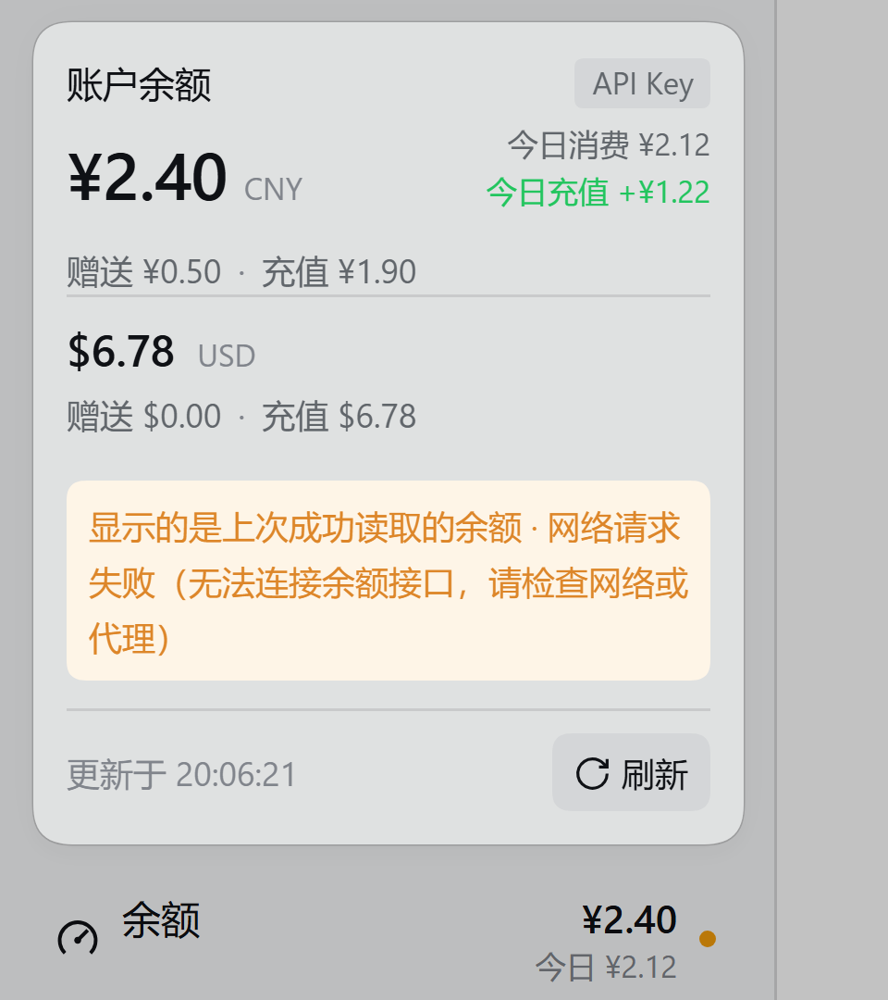
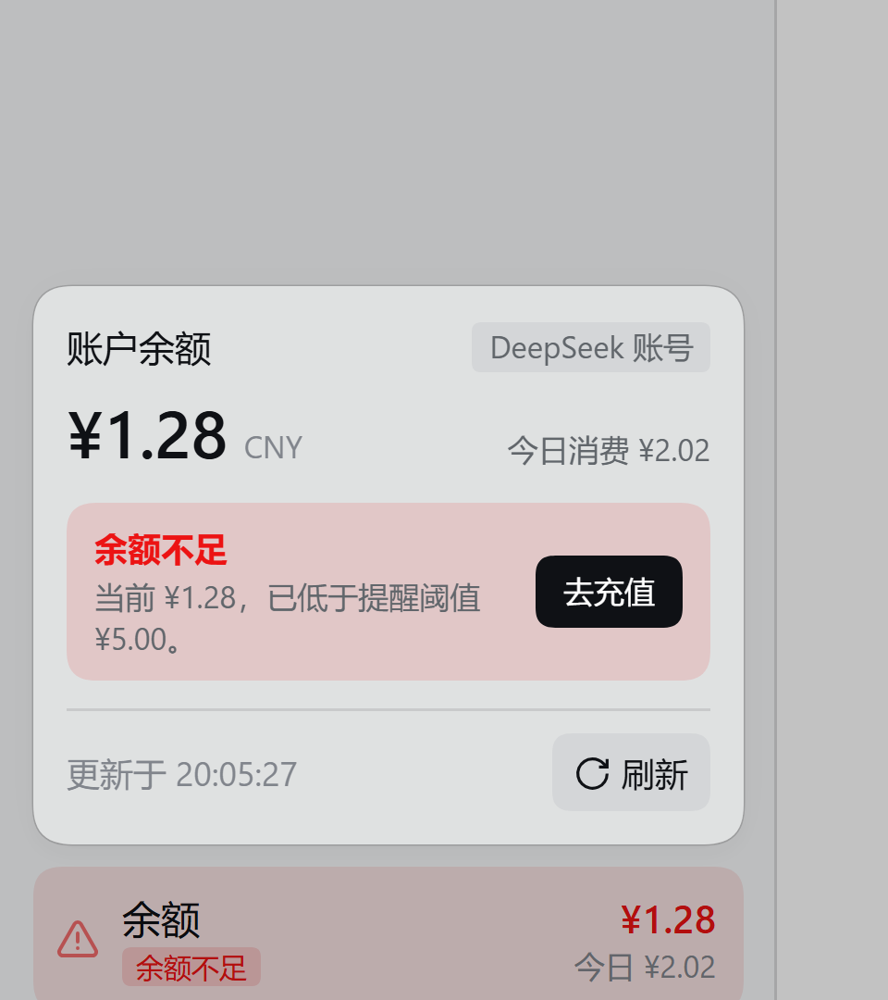
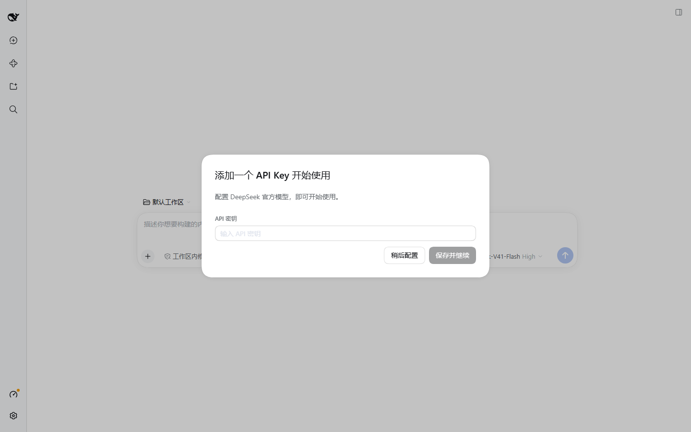

# dsh-balance

> 在 DeepSeek Harness 桌面端**侧边栏底部常驻显示账号余额**的插件。

[](https://github.com/Saln137/dsh-balance/actions/workflows/verify.yml)
[](https://github.com/Saln137/dsh-balance/releases)
[](LICENSE)



两行：第一行余额，第二行今日消费；点击展开明细。侧边栏折叠时自动收成 36×36 图标，异常状态在数字旁点一个状态点。
金额低于阈值（默认 ¥2）时整行转红、换成警示图标并显示「余额不足」：



| 明细浮层（正常态） | 明细浮层（取数失败，保留上次数字） |
| --- | --- |
|  |  |

| 明细浮层（低余额，账号路由带「去充值」） |
| --- |
|  |

| 侧边栏折叠（图标形态） |
| --- |
|  |

---

## 1. 它显示什么、放在哪里

**位置：侧边栏底部动作区（`sidebar.footer.action`），紧挨「设置」上方。**

选择理由：

| 候选位置 | 结论 |
| --- | --- |
| `sidebar.footer.action` ✅ | `kind: 'list'`（只追加、不抢占别人的坑位）、`scope: 'root'`（任何会话/任何页面状态都在），owner 还直接给出 `wide`，折叠时能自动切成图标 |
| `conversation.session.header.corner` ❌ | `single` 且已被「右侧栏展开按钮」占用，占用等于替换别人的呈现 |
| `shell.leading` ❌ | `single`，已被侧边栏标题控件占用 |
| `conversation.input.right` ❌ | 与会话强绑定，切到设置页/空态就消失；余额是全局信息 |

**显示内容：**

- 常驻双行：第一行「余额 + 金额」，第二行「今日消费」（没有数据时不留占位噪音）
- 低余额（默认 < ¥2）：整行转红、图标换成警示三角并缓慢呼吸、金额加粗，浮层顶部出现横幅与「去充值」
- 状态点（只在异常时出现）：黄 = 显示的是旧数据、红 = 读取失败、灰 = 未登录/未配置
- 明细浮层：大号余额、今日消费/充值、低余额横幅、各币种明细（金额、赠送/充值拆分）、数据来源徽标、更新时间、手动刷新
- 取数失败时：保留最后一次成功的数字并明确标注「显示的是上次成功读取的余额」，**绝不把余额显示成 0**

## 2. 「实时」是怎么做的

余额只在发生计费调用后才会变，所以刷新由三件事驱动，而不是一味缩短轮询：

1. **装配即读一次** —— 打开界面就有数字；
2. **每个回合结束**（`session/event` 的 `turn/end`）后 1.2 秒防抖刷新一次 —— 让平台账本先落账，比「把定时器调到 10 秒」更准也更省接口；
3. **后台定时器**（默认 60 秒）+ 浏览器侧每 5 秒轮询宿主快照（本地内存，不打上游）、页面重新可见/获得焦点时补一次、用户点「刷新」时走 `POST /refresh`。

宿主是**唯一的取数点**：多个窗口/标签页共享同一份快照，不会各拿一个定时器去刷官方接口。

## 3. 数据来源

| 模式 | 行为 |
| --- | --- |
| `auto`（默认） | 先查已登录的 DeepSeek 账号（`ctx.deepseekAccount.getBalance`）；未登录/读取失败再退回 API Key 路由（`GET {baseUrl}/user/balance`，Bearer） |
| `account` | 只查账号余额 |
| `api-key` | 只查 API Key 余额 |

- 账号服务与凭据服务都是**软取**：没装账号插件、没配 Key 时插件照常装配，只是如实显示「未登录 / 未配置」并告诉用户去哪里处理。
- 凭据只经 DSH 的 credentials 服务解析（引用名默认 `DEEPSEEK_API_KEY`），**不读配置文件、不进日志、不出进程**。
- 响应解析采取「非法即失败」：字段缺失、金额不是数字、`balance_infos` 为空一律报错，不补 0（0 余额和读不到余额是两件事）。

### 今日消费的口径

DeepSeek 没有向本地暴露逐笔账单的接口（DSH 设置里的「用量」只是个跳转链接），所以今日消费用**余额变动**推算：

- 相邻两次读数**余额减少** → 计入今日消费；
- 相邻两次读数**余额增加** → 计入今日充值/退款（单独显示，不冲抵消费，所以「充 100 花 2」显示消费 2、充值 100）；
- 跨天（默认按北京时间，可配 `dayTimeZone`）→ 重置基准；
- 账本落在 `$DSH_HOME/dsh-balance/ledger.json`，重启后当天数据不丢；只在插件运行期间观测，关掉应用的时间段没有读数。

已知边界：充值恰好抵消消费发生在同一次读数间隔内时无法区分方向（余额本身不带方向信息）。这是该口径的固有上限，换来的是不依赖任何私有接口、也不需要硬编码价目表。

状态取值：

```text
loading        首次读取中
ready          正常
stale          曾经成功、最近一次失败（保留旧数字 + 错误说明）
signed-out     账号未登录且没有其它凭据
no-credential  完全没有可用凭据
failed         读取失败且没有可回退的数据
```

## 4. 配置

在 profile 的 `cordis.patch.yml` 里按 `id: dsh-balance` 覆盖即可（bundle 自带一层默认值）。全部可省略：

| 配置项 | 默认 | 说明 |
| --- | --- | --- |
| `source` | `auto` | `auto` / `account` / `api-key` |
| `apiKeyRef` | `DEEPSEEK_API_KEY` | API Key 路由使用的凭据引用名 |
| `baseUrl` | `https://api.deepseek.com` | 官方接口根地址（可指向代理，允许带路径前缀） |
| `refreshIntervalSeconds` | `60` | 宿主后台刷新间隔，夹紧到 15–3600 |
| `pollIntervalSeconds` | `5` | 下发给浏览器的轮询间隔，夹紧到 5–600 |
| `requestTimeoutMs` | `15000` | 单次 HTTP 超时，夹紧到 3000–60000 |
| `locale` | `zh-CN` | 账号接口要求的调用方语言（只影响服务端文案） |
| `displayCurrency` | `auto` | 常驻行显示哪个币种：`auto` / `CNY` / `USD` |
| `showInRail` | `true` | 侧边栏折叠成图标栏时是否仍显示 |
| `todaySpend` | `true` | 是否统计并展示今日消费 |
| `lowBalanceThresholds` | `{ CNY: 2, USD: 0.3 }` | 低余额告警阈值（币种 → 金额），`0` 表示该币种不告警；只写关心的币种 |
| `dayTimeZone` | `Asia/Shanghai` | 计算「今天」用的时区（DeepSeek 按北京时间计费） |
| `debug` | `false` | 输出刷新来源等调试日志（不含凭据） |

示例：

```yaml
- id: dsh-balance
  name: 'dsh-balance'
  config:
    source: api-key
    displayCurrency: USD
    refreshIntervalSeconds: 30
```

## 5. 安装

### 5.1 装进本机 desktop profile（已执行）

```sh
node scripts/install.mjs                      # 默认 profile = desktop，$DSH_HOME=~/.dsh
node scripts/install.mjs --profile <名字>      # 其它 profile
node scripts/install.mjs --dry-run            # 只看会改什么
node scripts/install.mjs --uninstall          # 移除
```

脚本只做最小改动，并且**可回退**：

1. 首次安装时把 `profiles/<name>/package.json` 备份为 `package.json.bak-dsh-balance`；
2. 在 `dependencies` 里加一条 `"dsh-balance": "link:<本仓库绝对路径>"`（以后无论谁跑 pnpm install 都不会丢）；
3. 在 `dsh.profile.bundles` 末尾追加 `dsh-balance`；
4. 在 `profiles/<name>/node_modules/dsh-balance` 建一个指向本仓库的 junction。

> 为什么不用 `dsh plugin --profile desktop add ...`：desktop profile 被 Electron 独占（CLI 会直接拒绝：*profile "desktop" is managed exclusively by the Electron application*），而且 `dsh plugin` 会驱动 pnpm 重新解析整个 profile 依赖，可能顺带升级你已装的其它插件。这里只动本插件需要的三处。

**装完需要重启 DeepSeek Harness**：profile 的 bundle 列表和插件模块在启动时装配，热更新只覆盖「已在跑」的插件产物。

### 5.2 分发成可安装的 bundle

本包已是标准 DSH bundle（`dsh.bundle.patch` + `dsh.client`），可直接打包分发：

```sh
pnpm release                                  # 构建 + 产出 dsh-balance-0.1.0.tgz
dsh plugin --profile <名字> add ./dsh-balance-0.1.0.tgz
```

### 5.3 从 GitHub 安装

**A. 用 Release 里的 tarball（推荐）**：用户不需要批准任何构建脚本。

1. 本地 `pnpm release` 生成 `dsh-balance-x.y.z.tgz`；
2. 在 GitHub 建一个 Release，把 tgz 作为附件上传；
3. 用户下载后：`dsh plugin --profile <名字> add ./dsh-balance-x.y.z.tgz`。

**B. 直接装仓库**（需要用户批准一次构建）：

```sh
dsh plugin --profile <名字> add github:<owner>/dsh-balance
```

本包带 `prepare`（等于 `tsdown`），pnpm 会在安装后构建 `lib/`。pnpm ≥10 默认拒绝执行 git 依赖的构建脚本，
首次 `add` 会失败并在 profile 的 `pnpm-workspace.yaml` 里给出待批准项，把它写成
`allowBuilds: { dsh-balance: true }` 后重跑即可。注意：**批准构建等于允许该包在你的机器上执行安装期代码**，
只对信任的仓库这么做；生产建议钉死提交：`github:<owner>/dsh-balance#<sha>`。

## 6. 验证

```sh
pnpm install
pnpm verify        # tsc --noEmit + 83 个单测 + 构建 + 产物契约检查
```

GitHub Actions 在每次 push / PR 上跑同一条命令（[.github/workflows/verify.yml](.github/workflows/verify.yml)）。

`scripts/verify-bundles.mjs`（`pnpm verify` 的最后一步）只检查**构建产物**，因为 DSH 实际加载的就是产物：

- `package.json` 的 `dsh.bundle.patch` / `dsh.client` / `exports` 是否齐全，指向的文件是否存在；
- 宿主产物是否**只依赖 `node:` 内置模块**、是否真的导出 `apply/inject/name`；
- 客户端产物是否**没有顶层 import/export**、是否用包名登记了 factory；
- 用假 ctx 跑一遍 `apply()`：宿主能否注册出 `/dsh-balance` 路由并回 JSON（200/404/405），客户端能否注册进 `sidebar.footer.action`。

### 真实进程端到端（本次已跑通）

`scripts/verify/` 里留了可复用的道具，用**临时 DSH_HOME + 假余额接口**跑真实宿主，不接触真实凭据：

```sh
# 1) 假接口（按官方 GET /user/balance 的响应形状）
node scripts/verify/mock-balance.mjs 6398

# 2) 用临时 profile 启动一个隔离实例（profile 里把 baseUrl 指向假接口、apiKeyRef 指向假 Key）
DSH_HOME=<临时目录> DSH_BALANCE_TEST_KEY=sk-mock \
  dsh --profile verify --no-open --port 6399

# 3) 断言：boot graph 含本插件、客户端产物可取、/state 返回假接口里的数字、手动刷新真的打了上游
node scripts/verify/e2e.mjs "http://127.0.0.1:6399/?token=<启动 URL 里的令牌>" http://127.0.0.1:6398

# 4) 截图（走 CDP；`chrome --screenshot` 会被页面的长连接挂住）
node scripts/verify/screenshot.mjs "<authenticated url>" out.png 6000 1440 900
```

同一套检查也在**真实 desktop 实例**上跑过（重启后）：`GET /dsh-balance/state` 返回
`{"status":"ready","source":"account",…}` —— 走的是登录账号路由（`deepseekAccount.getBalance`），
侧边栏底部的数字随本会话的计费消耗同步变化；`POST /refresh` 会推进 `checkedAt`。

本次验证结果：客户端条目被发现、`/plugins/.../dsh-balance/client.js` 可取（页面共 10.8 MB combo）、
`GET /dsh-balance/state` 返回 `ready` 且金额与假接口一致、`POST /refresh` 让上游命中数 +1、未知子路径 404、
断开上游后状态转为 `stale` 且旧数字保留。

同一套脚本还覆盖了这一版新增的行为：

- 假接口每次查询递减余额 → `today.byCurrency.CNY.spent` 随之增长（0.05 → 0.10 → …）；
- 重启实例后今日消费从 `0.60` 继续累计（账本落盘生效，不归零）；
- 阈值调到 ¥5 时 `low.active=true` 且界面整行转红、浮层出现「余额不足」横幅；
- 用假账号服务跑 `source=account` 分支：`topUpUrl` 进快照，横幅出现「去充值」按钮。

`scripts/verify/e2e.mjs` 用 `--expect-low` / `--account` 两个开关分别打开低余额与账号路由的断言。

## 7. 架构

```text
浏览器                                  宿主进程（DSH）
┌──────────────────────────┐            ┌─────────────────────────────────────┐
│ sidebar.footer.action     │  GET 5s    │ /dsh-balance/state  ──► 快照(内存)   │
│  .dshb-trigger / .dshb-pop│ ─────────► │ /dsh-balance/refresh ─► 强制刷新     │
│  React 组件（单文件脚本）  │            │                                     │
└──────────────────────────┘            │ refresh() 去重 ─► readBalance()      │
                                        │   ├─ deepseekAccount.getBalance()    │
                                        │   └─ credentials → GET user/balance  │
                                        │ 触发：启动 / 60s / turn/end / 手动    │
                                        └─────────────────────────────────────┘
```

- **宿主半侧**（`src/host/`）：`config`（配置归一化）→ `sources`（来源编排）→ `parse`（响应校验）→ `ledger`（今日消费与低余额判定）→ `store`（快照与 stale 语义）→ `index`（Cordis 装配、路由、定时器、会话监听）。
- **浏览器半侧**（`src/client/`）：`index`（`__ModuleLoader__.load` 外壳）→ `app`（插件三件套 + 插槽注册）→ `widget`（React 组件）→ `styles`（一次性注入的样式表）→ `locales`（中/英字典）。
- **共享**（`src/shared/`）：`types`（唯一的线上契约）、`format`（金额/时间格式化，纯函数）。

两个产物都**不 import 任何 `@deepseek-ai/*` 运行时模块**：宿主只用 `ctx.get()` 软取服务，浏览器只用 `require('react')` 等平台种子模块。因此产物自包含，可跨 DSH 版本安装，也不会给宿主引入重复的 cordis 实例。

`GET /dsh-balance/state` 的响应（也是唯一的线上契约）：

```jsonc
{
  "status": "ready",              // loading | ready | stale | signed-out | no-credential | failed
  "source": "account",            // account | api-key | none
  "wallets": [                    // 服务端原始金额字符串，格式化只在展示层做
    { "currency": "CNY", "total": "128.4500", "granted": "18.45", "toppedUp": "110.00" }
  ],
  "updatedAt": 1792923813096,      // 最近一次成功
  "checkedAt": 1792923815383,      // 最近一次尝试
  "error": "…",                    // 仅失败时存在
  "pollMs": 5000,
  "displayCurrency": "auto",
  "showInRail": true,
  "today": {                       // 今日账本（todaySpend=false 或还没读数时是 null）
    "date": "2026-10-25",          // 按 dayTimeZone（默认北京时间）
    "byCurrency": {
      "CNY": { "spent": "0.45", "toppedUp": "0", "startBalance": "3.73" }
    }
  },
  "low": {                         // 低余额告警（未触发时为 null）
    "active": true,
    "currency": "CNY",
    "threshold": "2.00",
    "balance": "1.28"
  },
  "topUpUrl": "https://platform.deepseek.com/top_up"  // 仅账号路由提供的充值页
}
```

## 8. 兼容性与边界

- 依赖的宿主能力：`webServer`（必需，装配前提）、`credentials`、`deepseekAccount`、`session/event`；浏览器侧 `slots`、`locale`、`sidebar.footer.action` 插槽与 `window.__ModuleLoader__`。
- 账号服务缺失（例如只用 API Key 的组合）不影响装配，会退到 API Key 路由。
- `sidebar.footer.action` 在「Windows 标题栏 + 侧边栏折叠」时被平台整体隐藏（`设置` 一起隐藏），这是侧边栏自身的行为，不是本插件额外限制。
- 只读：不发起充值、不代登录。低余额横幅里的「去充值」是账号服务提供的外链（`topUpUrl`），没有该链接时不显示按钮。
- 失败详情文案为中文（面向当前使用场景）；界面骨架文案已做中/英双语。

## 9. 目录

```text
src/host/        宿主半侧（config / sources / parse / ledger / store / index / context）
src/client/      浏览器半侧（index / app / widget / styles / locales / context）
src/shared/      两侧共享的线上契约与格式化
test/            83 个纯函数单测（node --test，直接跑 .ts）
scripts/         install.mjs、verify-bundles.mjs、verify/（假接口 + e2e + 截图）
docs/            截图
.github/         CI（push / PR 跑 pnpm verify）
cordis.patch.yml bundle 配置层
LICENSE          MIT
```

## License

MIT
